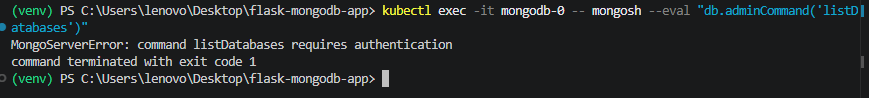
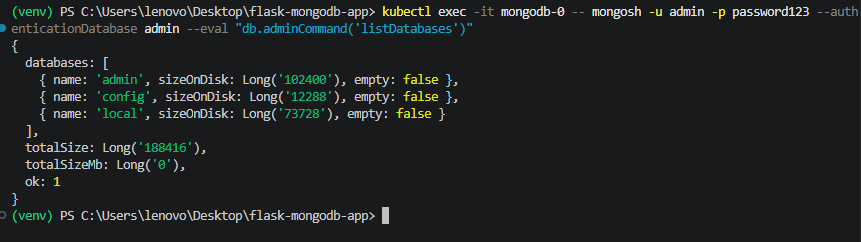
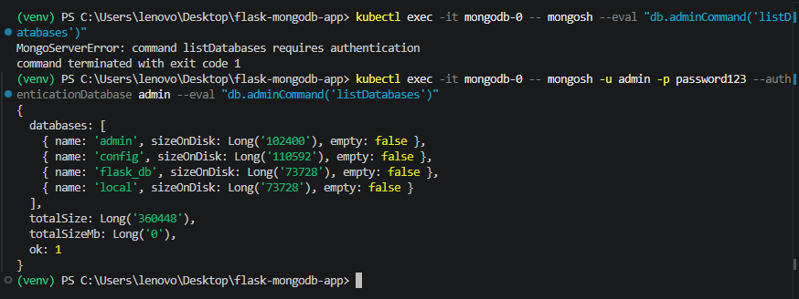
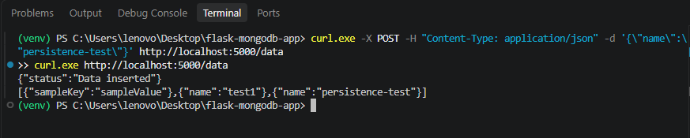
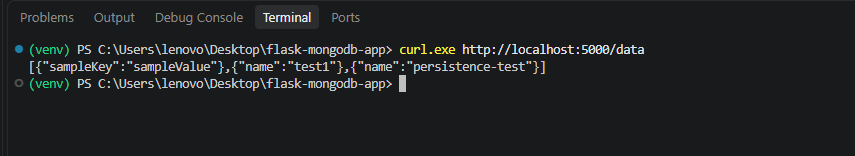
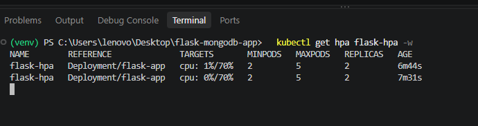
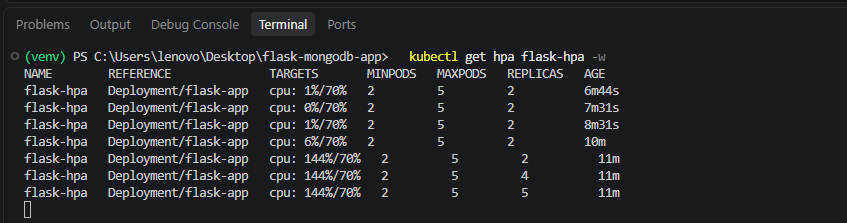
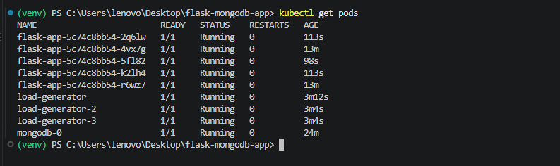
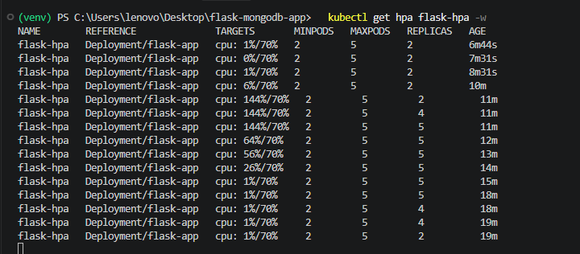

# Flask + MongoDB on Kubernetes (Minikube)

A Python Flask application connected to a MongoDB database, deployed on a local Minikube cluster with authentication, persistent storage, autoscaling and resource management.

## Endpoints

| Endpoint | Method | Description                                                              |
| -------- | ------ | ------------------------------------------------------------------------ |
| `/`      | GET    | Returns "Welcome to the Flask app! The current time is: <Date and Time>" |
| `/data`  | POST   | Inserts the JSON body into MongoDB                                       |
| `/data`  | GET    | Returns all stored documents                                             |

## Project Structure

```
flask-mongodb-app/
├── app.py
├── requirements.txt
├── Dockerfile
├── .dockerignore
├── README.md
└── k8s/
    ├── mongo-secret.yaml
    ├── mongo-pv-pvc.yaml
    ├── mongo-statefulset.yaml
    ├── mongo-service.yaml
    ├── flask-deployment.yaml
    ├── flask-service.yaml
    └── flask-hpa.yaml
```

## Prerequisites

- Docker Desktop (running)
- Minikube
- kubectl
- A Docker Hub account (this project uses `vedantshrivastav`)

---

## 1. Build and Push the Docker Image

```bash
# Build
docker build -t vedantshrivastav/flask-mongo-app:v1 .

# Log in to Docker Hub
docker login

# Push
docker push vedantshrivastav/flask-mongo-app:v1
```

### Dockerfile

```dockerfile
FROM python:3.9-slim
WORKDIR /app
COPY requirements.txt .
RUN pip install --no-cache-dir -r requirements.txt
COPY app.py .
EXPOSE 5000
CMD ["python", "app.py"]
```

Dependencies are installed before copying `app.py`, so Docker caches that layer and rebuilds are fast when only the code changes.

---

## 2. Deploy on Minikube

### Start the cluster

```bash
minikube start --driver=docker --cpus=2 --memory=4096
minikube addons enable metrics-server
kubectl get nodes
```

`metrics-server` is required for the Horizontal Pod Autoscaler to read CPU usage.

### Apply all manifests

```bash
kubectl apply -f k8s/
```

### Verify

```bash
kubectl get pods
kubectl get pv,pvc
kubectl get svc
kubectl get hpa
```

Expected: `mongodb-0` and two `flask-app` pods are `1/1 Running`, the PVC is `Bound`, and the HPA shows a CPU percentage.

### Access the app from your machine

Option A (Minikube service URL):

```bash
minikube service flask-service --url
```

Option B (port-forward):

```bash
kubectl port-forward service/flask-service 5000:5000
```

Test (Windows PowerShell uses `curl.exe`):

```bash
curl.exe http://localhost:5000/
curl.exe -X POST -H "Content-Type: application/json" -d '{\"sampleKey\":\"sampleValue\"}' http://localhost:5000/data
curl.exe http://localhost:5000/data
```

---

## 3. Kubernetes Resources

| File                     | Resource                | Purpose                                  |
| ------------------------ | ----------------------- | ---------------------------------------- |
| `mongo-secret.yaml`      | Secret                  | Stores the MongoDB username and password |
| `mongo-pv-pvc.yaml`      | PV + PVC                | 1Gi persistent storage for MongoDB data  |
| `mongo-statefulset.yaml` | StatefulSet             | MongoDB with authentication enabled      |
| `mongo-service.yaml`     | Service (ClusterIP)     | Internal-only access to MongoDB          |
| `flask-deployment.yaml`  | Deployment (2 replicas) | The Flask application                    |
| `flask-service.yaml`     | Service (NodePort)      | Exposes Flask outside the cluster        |
| `flask-hpa.yaml`         | HPA                     | Scales Flask 2 to 5 replicas at 70% CPU  |

### How authentication is enabled

The official MongoDB image creates a root user and turns on authentication when the environment variables `MONGO_INITDB_ROOT_USERNAME` and `MONGO_INITDB_ROOT_PASSWORD` are set. Both come from the `mongo-secret` Secret. Flask reads the same Secret and connects with `username`, `password` and `authSource="admin"`.

### How persistence works

The PVC `mongo-pvc` binds to the PV `mongo-pv` (storage class `manual`, `hostPath: /data/mongo`). It is mounted at `/data/db`, the directory where MongoDB stores its data. Data survives pod deletion and restarts.

---

## 4. DNS Resolution in Kubernetes

Every Kubernetes cluster runs a DNS server (CoreDNS). Whenever a Service is created, CoreDNS automatically creates a DNS record for it:

```
<service-name>.<namespace>.svc.cluster.local
```

For the MongoDB Service in the `default` namespace this is:

```
mongodb-service.default.svc.cluster.local
```

How it works step by step:

1. Every pod's `/etc/resolv.conf` points to the cluster DNS server and includes search domains such as `default.svc.cluster.local`.
2. When the Flask pod looks up `mongodb-service`, the search domains are appended automatically, so the short name resolves to the full name above.
3. CoreDNS returns the **ClusterIP** of the Service.
4. `kube-proxy` forwards traffic sent to that ClusterIP to a healthy pod matching the Service's selector (`app: mongodb`).

Pod IPs change every time a pod is recreated, but the Service name and ClusterIP stay stable. That is why we use the name instead of an IP.

**How Flask connects to MongoDB:** the Deployment sets `MONGO_HOST=mongodb-service`, and `app.py` passes it to `MongoClient(host=...)`. No IP address is hardcoded. Because the Service is `ClusterIP`, MongoDB is reachable only from inside the cluster.

---

## 5. Resource Requests and Limits

**Requests** are the amount of CPU and memory Kubernetes _guarantees_ to a container. The scheduler uses requests to decide which node a pod can be placed on. The HPA also calculates CPU utilization as a percentage of the request.

**Limits** are the _maximum_ a container may use.

- If a container exceeds its **CPU limit**, it is throttled (slowed down).
- If it exceeds its **memory limit**, it is killed (`OOMKilled`) and restarted.

**Why they matter:** they prevent one pod from starving others, make scheduling predictable, keep the node stable, and make CPU-based autoscaling possible.

Values used for both Flask and MongoDB:

|         | CPU            | Memory |
| ------- | -------------- | ------ |
| Request | 200m (0.2 CPU) | 250M   |
| Limit   | 500m (0.5 CPU) | 500M   |

MongoDB is started with `--wiredTigerCacheSizeGB 0.25` so its internal cache stays under the 500M memory limit and the pod is not OOMKilled.

---

## 6. Design Choices

| Choice                            | Reason                                                                          | Alternatives considered                                                                             |
| --------------------------------- | ------------------------------------------------------------------------------- | --------------------------------------------------------------------------------------------------- |
| **Minikube (Docker driver)**      | Free, simple, runs locally                                                      | kind, k3d, Docker Desktop Kubernetes: also fine, Minikube has simple add-ons such as metrics-server |
| **StatefulSet for MongoDB**       | Gives a stable pod name (`mongodb-0`) and stable storage, which suits databases | A Deployment would work for 1 replica, but does not give stable identity                            |
| **1 MongoDB replica**             | One PVC, simple, enough for the assignment                                      | A replica set (3 pods) gives high availability but needs extra setup beyond the scope               |
| **ClusterIP for MongoDB**         | Keeps the database private inside the cluster                                   | NodePort/LoadBalancer would expose the DB, which is insecure                                        |
| **NodePort for Flask**            | Works on Minikube without a cloud load balancer                                 | LoadBalancer (needs `minikube tunnel`), Ingress (extra controller)                                  |
| **Secret for credentials**        | Keeps credentials out of the image and the Deployment spec                      | Hardcoding in code or plain env values: insecure                                                    |
| **Static PV with hostPath**       | Explicitly meets the PV + PVC requirement                                       | Dynamic provisioning with the default StorageClass (simpler, but less explicit)                     |
| **HPA on CPU (`autoscaling/v2`)** | Required by the assignment: 70% target, 2 to 5 replicas                         | Memory-based or custom-metric scaling                                                               |
| **`python:3.9-slim`**             | Small image, compatible with the pinned Flask 2.0.2                             | Full Python image (much larger), Alpine (can have build issues)                                     |

**Security note:** the credentials in `mongo-secret.yaml` are sample values for this exercise. In production, use a secret manager or sealed secrets, and do not commit passwords to Git. Kubernetes Secrets are only base64-encoded, not encrypted, by default.

---

## 7. Testing

### 7.1 Authentication test

Without credentials (fails):

```bash
kubectl exec -it mongodb-0 -- mongosh --eval "db.adminCommand('listDatabases')"
```

Result: the command fails because authentication is required.



With credentials (succeeds):

```bash
kubectl exec -it mongodb-0 -- mongosh -u admin -p password123 --authenticationDatabase admin --eval "db.adminCommand('listDatabases')"
```

Result: the command succeeds and lists the databases.





### 7.2 Database interaction and persistence test

1. Inserted records through `POST /data` and read them back with `GET /data`.
2. Deleted the MongoDB pod: `kubectl delete pod mongodb-0`.
3. After the StatefulSet recreated `mongodb-0`, ran `GET /data` again.

Data before deleting the pod:



Data after `mongodb-0` was recreated:



Result: the same records are still returned, which confirms the PV/PVC keeps data across pod restarts.

### 7.3 Autoscaling test (simulated high traffic)

**Method:** started busybox pods inside the cluster that send continuous requests to the Flask Service:

```bash
kubectl run load-generator --image=busybox:1.36 --restart=Never -- /bin/sh -c "while true; do wget -q -O- http://flask-service:5000/ > /dev/null; done"
```

Additional generators (`load-generator-2`, `load-generator-3`) were started to increase load. Requests go through the Service, so traffic is spread across all Flask pods. Progress was watched with:

```bash
kubectl get hpa flask-hpa -w
kubectl get pods -w
```

**Results:**

| Stage              | CPU (target 70%) | Replicas                                           |
| ------------------ | ---------------- | -------------------------------------------------- |
| Before load        | 1% to 8%         | 2                                                  |
| During load        | 144%             | 2, then 4, then 5 (maximum)                        |
| After load stopped | drops to near 0% | back to 2 after the ~5 minute stabilization window |

The HPA scaled up to the maximum of 5 replicas, and the new pods moved through `Pending`, `ContainerCreating` and `Running`. After the load generators were deleted, the HPA scaled back down to the minimum of 2 replicas.

**HPA before the load test** (2 replicas, low CPU)



**HPA during the load test** (CPU at 144%, replicas reached the maximum of 5)



**Flask pods during the load test** (5 pods running)



**HPA after the load stopped** (back to 2 replicas)



### 7.4 Issues encountered

| Issue                                                                             | Cause                                                                               | Fix                                                                                     |
| --------------------------------------------------------------------------------- | ----------------------------------------------------------------------------------- | --------------------------------------------------------------------------------------- |
| `curl -X POST ...` failed in PowerShell with a `Headers` parameter error          | In PowerShell, `curl` is an alias for `Invoke-WebRequest`                           | Used `curl.exe` (or `Invoke-RestMethod`)                                                |
| `mongodb-0` stuck in `Pending` with `persistentvolumeclaim "mongo-pvc" not found` | `mongo-pv-pvc.yaml` was saved empty (0 bytes), so the PV and PVC were never created | Pasted the content, saved the file and re-applied it. Checked file sizes with `dir k8s` |
| `mongodb-0` stayed in `ContainerCreating` for several minutes                     | Slow first-time pull of the `mongo:6.0` image                                       | Waited for the pull to finish (optionally `minikube image load mongo:6.0`)              |
| `minikube` was not recognized in the terminal                                     | PATH was not refreshed in the open terminal after install                           | Opened a new terminal, or used `kubectl port-forward` to reach the app                  |
| HPA showed `<unknown>` CPU at first                                               | metrics-server needs a short warm-up                                                | Enabled the `metrics-server` add-on and waited about a minute                           |

---

## 8. Cleanup

```bash
kubectl delete -f k8s/
minikube stop
# minikube delete   (removes the cluster completely)
```
